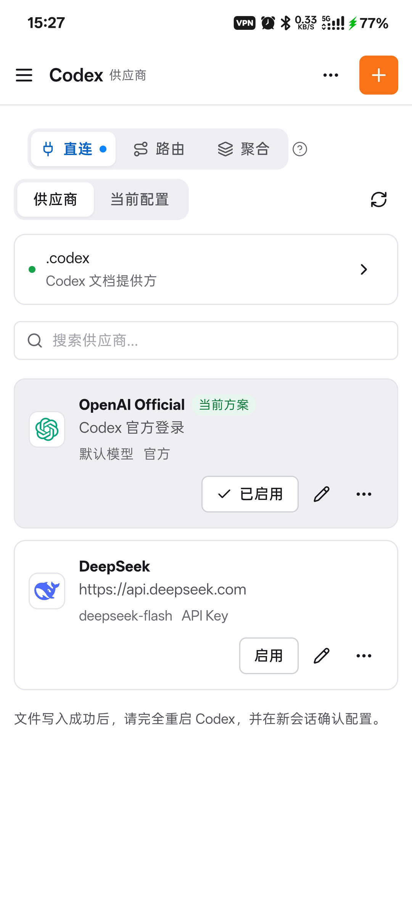

# Codex Desktop Android

https://github.com/user-attachments/assets/106fb10e-1151-4f02-9a93-da7b29ec0529


Codex Android 是基于 FoldGPT 的独立适配项目，把 Linux ARM64 版 ChatGPT 桌面客户端带到 Android 上。它提供简体中文界面、启动全屏、共享存储项目，以及带屏幕边缘提示的前台手机操控。


## 功能亮点

- **把 Codex 桌面工作区带到手机上**：使用 Linux ARM64 桌面客户端，在手机上进行项目对话、阅读代码、修改文件和执行命令。
- **手机本地开发环境**：Debian 运行环境与本地执行器配合，支持拉取项目、安装依赖和编译构建；可访问已授权的共享存储项目，适合随身继续开发。
- **ColorOS 17 灵动岛实时状态**：Codex 工作时展示思考、命令执行、文件修改等状态；操控手机时显示“看屏幕”“点击”“输入”等具体动作，无需一直停留在应用内查看。
- **通过 MCP 操控手机**：授权无障碍服务后，Codex 可读屏、点击、滑动和输入；提供任务状态悬浮窗，以及暂停、继续、接管和停止操作。
- **屏幕边缘动态光效**：手机操控期间以连续渐变光效提示工作状态，配合悬浮窗与灵动岛，让当前操作更直观。
- **高刷新率与中文输入**：随系统实际显示模式同步刷新率；提供简体中文界面，并优化系统输入法、焦点保持和键盘遮挡适配。
- **Android 工具与配置共享**：提供图形自动/兼容/加速模式和日志导出；通过系统文件选择器授权整个 `.codex` 目录，供独立 CC Switch 等应用读写配置。当前改动的跨应用读写及其他 GPU 实机表现待验证。

灵动岛展示由系统决定，实际帧率受系统设置、温控和负载影响。项目命令与桌面渲染在手机上运行，模型推理由在线服务完成。[实时状态与光效说明](docs/live-status-and-edge-glow.md) · [兼容性与验证范围](docs/compatibility.md)

## 使用说明

- **重要提醒**:请在手机开发者选项中，打开**停止限制子进程**选项，否则可能会导致使用过程中被系统强制终止。，因为agent工具在工作时会创建大量子进程

    如果没有这个选项，请用adb执行以下两条命令：
    ```bash
    device_config set_sync_disabled_for_tests persistent
    device_config put activity_manager max_phantom_processes 999999999
    ```

    
- 首次使用需要下载**环境包**，并将环境包放入Download文件夹（一般浏览器的默认下载目录就是这里 不用特意去移动）。
- 设置调整在应用快捷方式中（App Shortcuts）长按APP图标可以看到Android工具和Codex设置选项。


## 推荐搭配安卓版 CC Switch

<table>
  <tr>
    <td width="33%"></td>
    <td width="33%"></td>
    <td width="33%"></td>
  </tr>
</table>

推荐使用 [CC Switch Android](https://github.com/JinShichang/cc-switch-android) 管理多套服务商配置，切换 API 地址、API Key 和模型。它作为独立 Android 应用运行，通过系统文件选择器获得 Codex 配置目录的读写授权，无需 Root。

Codex v71 后已加入 DocumentsProvider，可向 CC Switch 提供整个 `.codex` 目录：

1. 启动一次 Codex，完成运行环境和配置目录初始化，然后安全退出桌面客户端。
2. 在 CC Switch 中点击“连接配置目录”，从系统文件选择器进入 **Codex → .codex**，选择“使用此文件夹”并授权。
3. 保存并应用服务商配置后，重新启动 Codex，建立新会话确认配置生效。

CC Switch 的安装包、使用说明和功能范围见其[项目主页](https://github.com/JinShichang/cc-switch-android)。

## 架构

- **Android 宿主**负责显示、触摸、键盘和运行时启停，通过内嵌的 Termux:X11 显示桌面客户端。
- **桌面与本地执行**使用 PRoot 提供 Debian 用户空间，运行 Linux ARM64 桌面客户端。适配后的 Codex `app-server` 通过 Android 原生执行器运行项目命令、访问工作区。模型推理由在线服务完成。
- **手机操控**通过本机 MCP 接入 Codex。前台读屏、点击和输入由 Android 无障碍服务执行，Root 功能单独授权。

当前应用包名为 `com.ai.codex`。[架构文档](docs/architecture.md) · [后端版本与补丁清单](recovery/engine/manifest.json)

## 使用 Agent 部署

建议在电脑上克隆仓库，用能读源码、运行终端命令的编程 Agent 协助部署。构建涉及 Android SDK、NDK、原生库、Codex 后端和 Debian 运行环境。桌面客户端需从 OpenAI 单独获取，并与仓库中的适配版本匹配。原生构建建议在 Linux 或 WSL 的 Linux 文件系统中进行。[构建指南](docs/build.md)

可直接把部署提示词交给 Agent，并附上你的构建系统、手机型号和 Android 版本。[Agent 部署指南](docs/agent-deployment.md)

公开源码从零构建并完成首次安装的全流程仍待验证。构建候选 APK 与准备完整运行环境是两个步骤。[候选包构建流程](docs/build-candidate.md) · [一加 13 兼容性与验证](docs/compatibility.md)

## 欢迎加入QQ群讨论


## 许可证

宿主及适配代码沿用 GPL-3.0-or-later。第三方组件保留各自的许可证和署名，桌面客户端由用户单独取得。[项目许可证](LICENSE) · [授权说明](LEGAL.md) · [第三方声明](THIRD_PARTY_NOTICES.md) · [手机操控上游声明](third-party/dsh-go-phone/THIRD_PARTY_NOTICES.md)

## 参考项目与致谢

感谢以下项目的作者和贡献者，他们的源码、实现和文档为这次移植提供了基础和参考。

- Android 宿主和桌面适配基于 Julien Piron 的 [FoldGPT](https://github.com/pironjulien/FoldGPT)。
- 本地后端基于 [OpenAI Codex](https://github.com/openai/codex)，Linux 桌面打包调研参考了 [codex-desktop-linux](https://github.com/ilysenko/codex-desktop-linux)。
- 前台手机操控移植自 [dsh-Go](https://github.com/ccch1mneyyy/dsh-Go)，其中部分实现源自 [Phase](https://github.com/CikeSeven/phase) 和 [DSHA](https://github.com/DSH-APP/DSHA)。设备命令白名单也参考了 DSHA。
- Android 原生实时通知参考了 [Duck Detector Refactoring](https://github.com/eltavine/Duck-Detector-Refactoring)，支持 Android 16 及以上的 Live Updates；是否显示为灵动岛或超级岛由系统和用户设置决定。
- 早期终端调研参考了 [Operit](https://github.com/AAswordman/Operit) 和 [OperitTerminalCore](https://github.com/AAswordman/OperitTerminalCore)。
- 显示与 Linux 环境使用 [Termux:X11](https://github.com/termux/termux-x11)、[PRoot](https://github.com/termux/proot)、[Debian](https://www.debian.org/)、[Mesa](https://www.mesa3d.org/)、[libandroid-shmem](https://github.com/termux/libandroid-shmem) 和 [talloc](https://talloc.samba.org/)。构建参考了 [Termux Packages](https://github.com/termux/termux-packages)。
- 设备连接使用 [libadb-android](https://github.com/MuntashirAkon/libadb-android) 和 [Shizuku API](https://github.com/RikkaApps/Shizuku-API)。安装和音频相关组件参考或使用了 [Apache Commons](https://commons.apache.org/) 和 [PulseAudio](https://www.freedesktop.org/wiki/Software/PulseAudio/)。
