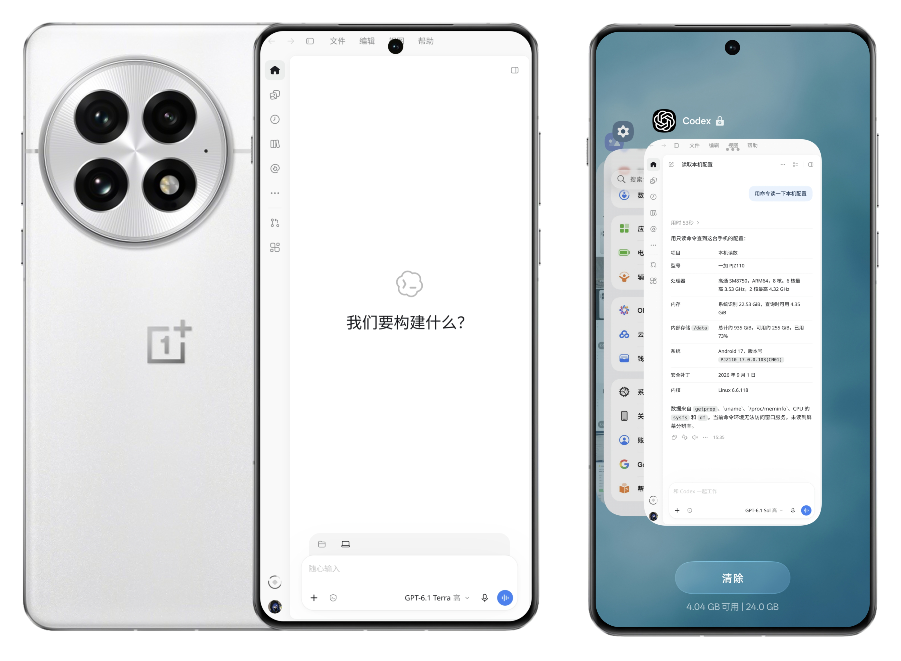

# Codex Android

Codex Android 是基于 FoldGPT 的独立适配项目，把 Linux ARM64 版 ChatGPT 桌面客户端带到 Android 上。它提供简体中文界面、启动全屏、共享存储项目，以及带屏幕边缘提示的前台手机操控。

**本项目只在一加 13（Android 17、ARM64）上做过实机测试，其他手机能否运行没有保证。仓库只提供源码，不计划发布 Release APK。**

## 架构

- **Android 宿主**负责显示、触摸、键盘和运行时启停，通过内嵌的 Termux:X11 显示桌面客户端。
- **桌面与本地执行**使用 PRoot 提供 Debian 用户空间，运行 Linux ARM64 桌面客户端。适配后的 Codex `app-server` 通过 Android 原生执行器运行项目命令、访问工作区。模型推理由在线服务完成。
- **手机操控**通过本机 MCP 接入 Codex。前台读屏、点击和输入由 Android 无障碍服务执行，Root 功能单独授权。

当前源码对应应用 `com.ai.codex` 的开发版，适配桌面客户端 `26.1103.31037`，后端基于 Codex `rust-v0.167.0`。[架构文档](docs/architecture.md) · [后端版本与补丁清单](recovery/engine/manifest.json)

## 使用 Agent 部署

建议在电脑上克隆仓库，用能读源码、运行终端命令的编程 Agent 协助部署。构建涉及 Android SDK、NDK、原生库、Codex 后端和 Debian 运行环境。桌面客户端需从 OpenAI 单独获取，并与仓库中的适配版本匹配。原生构建建议在 Linux 或 WSL 的 Linux 文件系统中进行。[构建指南](docs/build.md)

可直接把部署提示词交给 Agent，并附上你的构建系统、手机型号和 Android 版本。[Agent 部署指南](docs/agent-deployment.md)

公开源码从零构建并完成首次安装的全流程仍待验证。构建候选 APK 与准备完整运行环境是两个步骤。[候选包构建流程](docs/build-candidate.md) · [一加 13 兼容性与验证](docs/compatibility.md)

## 许可证

宿主及适配代码沿用 GPL-3.0-or-later。第三方组件保留各自的许可证和署名，桌面客户端由用户单独取得。[项目许可证](LICENSE) · [授权说明](LEGAL.md) · [第三方声明](THIRD_PARTY_NOTICES.md) · [手机操控上游声明](third-party/dsh-go-phone/THIRD_PARTY_NOTICES.md)

## 参考项目与致谢

感谢以下项目的作者和贡献者，他们的源码、实现和文档为这次移植提供了基础和参考。

- Android 宿主和桌面适配基于 Julien Piron 的 [FoldGPT](https://github.com/pironjulien/FoldGPT)。
- 本地后端基于 [OpenAI Codex](https://github.com/openai/codex)，Linux 桌面打包调研参考了 [codex-desktop-linux](https://github.com/ilysenko/codex-desktop-linux)。
- 前台手机操控移植自 [dsh-Go](https://github.com/ccch1mneyyy/dsh-Go)，其中部分实现源自 [Phase](https://github.com/CikeSeven/phase) 和 [DSHA](https://github.com/DSH-APP/DSHA)。设备命令白名单也参考了 DSHA。
- 早期终端调研参考了 [Operit](https://github.com/AAswordman/Operit) 和 [OperitTerminalCore](https://github.com/AAswordman/OperitTerminalCore)。
- 显示与 Linux 环境使用 [Termux:X11](https://github.com/termux/termux-x11)、[PRoot](https://github.com/termux/proot)、[Debian](https://www.debian.org/)、[Mesa](https://www.mesa3d.org/)、[libandroid-shmem](https://github.com/termux/libandroid-shmem) 和 [talloc](https://talloc.samba.org/)。构建参考了 [Termux Packages](https://github.com/termux/termux-packages)。
- 设备连接使用 [libadb-android](https://github.com/MuntashirAkon/libadb-android) 和 [Shizuku API](https://github.com/RikkaApps/Shizuku-API)。安装和音频相关组件参考或使用了 [Apache Commons](https://commons.apache.org/) 和 [PulseAudio](https://www.freedesktop.org/wiki/Software/PulseAudio/)。
